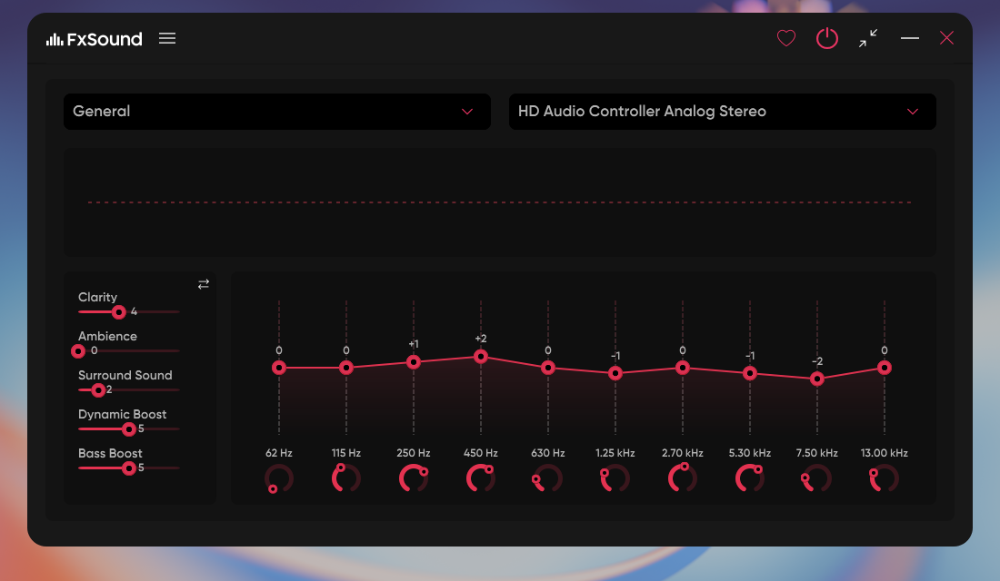

<p align="center">
  
</p>

<p align="center">
  <a href="https://github.com/tasin-py/FXSounds-Linux/releases/latest"></a>
  <a href="https://github.com/tasin-py/FXSounds-Linux/releases"></a>
  <a href="LICENSE"></a>
  <a href="https://github.com/tasin-py/FXSounds-Linux/commits/main"></a>
  <a href="https://github.com/tasin-py/FXSounds-Linux/releases/latest"></a>
</p>
<p align="center">
  <a href="https://github.com/tasin-py/FXSounds-Linux/stargazers"></a>
  <a href="https://github.com/tasin-py/FXSounds-Linux/network/members"></a>
  <a href="https://github.com/tasin-py/FXSounds-Linux/issues"></a>
  
  
</p>
<p align="center">
  
  
  
  
  
  
</p>
<p align="center">
  
  
  
  
  
  
  
</p>

<p align="center">
  <a href="#install"><b>Install</b></a> ·
  <a href="#features"><b>Features</b></a> ·
  <a href="#usage"><b>Usage</b></a> ·
  <a href="#troubleshooting"><b>Troubleshooting</b></a> ·
  <a href="#building-from-source"><b>Build</b></a> ·
  <a href="#support-the-project"><b>Support</b></a>
</p>

---

## What it does

**FxSound for Linux** is an unofficial port of [FxSound](https://github.com/fxsound2/fxsound-app), the free,
open-source audio enhancer for Windows. It makes everything you play sound better, whether that's music,
videos, games or calls: clearer voices, fuller bass, wider sound, and a 10-band equalizer you can shape yourself.

It is the **same app** as on Windows: the same window, the same presets, and the same sound. Its audio output
was compared sample by sample with the Windows build, and it is **bit-identical**.

On Linux, FxSound adds an output device called **FxSound** to PipeWire. While FxSound is on, it is your default
output: every app plays through it, and FxSound sends the enhanced sound to your real speakers or headphones.
When you switch FxSound off or quit, your normal output comes back.

<p align="center">
  
  <br><sub>FxSound on Arch Linux with KDE Plasma (Wayland)</sub>
</p>

## Features

| | |
|---|---|
| 🎚️ **10-band equalizer** | Drag the bands to shape the sound, the same as on Windows. |
| ✨ **Effects** | Clarity, Ambience, Surround Sound, Dynamic Boost and Bass Boost. |
| 🎵 **Presets** | All the presets from Windows: General, Movies, TV, Music, Voice, Gaming, Bass Boost and more. |
| 💾 **Your own presets** | Save, rename, delete, export and import presets (the same `.fac` files Windows uses). |
| 🔊 **Follows your devices** | Pick another output in your system's sound menu and FxSound plays there. Unplug headphones and it falls back to your speakers. |
| 🧭 **Tray icon** | Turn FxSound on or off, switch presets and outputs, without opening the window. |
| ⌨️ **Keyboard shortcuts** | On/off, next or previous preset, next output, show/hide (X11). |
| 🚀 **Launch on login** | One switch in Settings. |
| 🔄 **Check for updates** | Asks this repository's Releases whether there is a newer version. |
| 📋 **Copy Log** | Copies a diagnostic report to the clipboard for bug reports. |
| ❤️ **Two ways to support** | The ♥ button asks whom you'd like to support: the Linux port developer or the FxSound core developers. |
| 🪶 **Light** | Native C++ with no Electron and no background services. FxSound runs only while you use it. |

## Install

### One command (recommended)

Open a terminal and paste:

```sh
curl -fsSL https://raw.githubusercontent.com/tasin-py/FXSounds-Linux/main/get.sh | sh
```

The installer finds the latest release, checks your distro and installs the right package. It asks for your
password because it installs for all users. Downloads are checked against the release's `SHA256SUMS`.

| Option | What it does |
|---|---|
| `curl -fsSL …/get.sh \| sh -s -- --user` | Installs only for you, in your home folder. No password needed. |
| `curl -fsSL …/get.sh \| sh -s -- --uninstall` | Removes FxSound. Your settings and presets are kept. |

### Or download a package

Get the file for your distro from the [**latest release**](https://github.com/tasin-py/FXSounds-Linux/releases/latest):

| Distro | File | Install |
|---|---|---|
| Ubuntu 24.04+, Debian 13+, Mint 22+, Pop!_OS, Kali | `fxsound_<ver>_amd64.deb` | `sudo apt install ./fxsound_*_amd64.deb` |
| Fedora 40+ | `fxsound-<ver>-1.x86_64.rpm` | `sudo dnf install ./fxsound-*.x86_64.rpm` |
| openSUSE Tumbleweed | `fxsound-<ver>-1.x86_64.rpm` | `sudo zypper install ./fxsound-*.x86_64.rpm` |
| Arch, Manjaro, EndeavourOS | `fxsound-bin-<ver>-1-x86_64.pkg.tar.zst` | `sudo pacman -U ./fxsound-bin-*.pkg.tar.zst` |
| Any other distro | `FxSound-<ver>-linux-x86_64.tar.gz` | Extract it, then run `./install.sh` (no root needed) |

### Requirements

* A 64-bit PC (x86_64).
* A current distro: glibc 2.39 or newer (Ubuntu 24.04+, Debian 13+, Fedora 40+, or any rolling distro).
* **PipeWire** for sound. It's the default on all the distros above.
* For the tray icon: `libayatana-appindicator`. The packages install it for you; `install.sh` tells you if it's missing.

## Usage

**Start FxSound** from your applications menu, or run `fxsound` in a terminal. The window and the presets work
the same as on Windows.

* **Turn it on or off** with the power button at the top. When it's off, your normal output is used directly.
* **Choose a preset** from the list at the top left. Change any slider, then save the result as your own preset.
* **Choose where the sound goes** from the device list at the top right, or in your desktop's own sound menu.
  FxSound follows either one.
* **Close the window** and FxSound keeps running in the tray. Use *Exit* in the tray menu to quit.

### Keyboard shortcuts (X11)

| Shortcut | Action |
|---|---|
| <kbd>Ctrl</kbd> + <kbd>Shift</kbd> + <kbd>Q</kbd> | Turn FxSound on or off |
| <kbd>Ctrl</kbd> + <kbd>Shift</kbd> + <kbd>A</kbd> / <kbd>Z</kbd> | Next / previous preset |
| <kbd>Ctrl</kbd> + <kbd>Shift</kbd> + <kbd>W</kbd> | Next output device |
| <kbd>Ctrl</kbd> + <kbd>Shift</kbd> + <kbd>E</kbd> | Show or hide the window |

You can change them in *Settings*. Wayland doesn't let apps grab keys globally. There, add shortcuts in your
desktop's keyboard settings that run the commands below.

### Command line

A command sent while FxSound is already running goes to that window. FxSound never starts twice.

```sh
fxsound --power=0          # turn off
fxsound --power=1          # turn on
fxsound --preset="Music"   # switch preset
```

### Files

| What | Where |
|---|---|
| Settings and your presets | `~/.config/FxSound/` |
| Log | `~/.config/FxSound/fxsound.log` (or menu → **Copy Log**) |
| App (package install) | `/opt/fxsound` |
| App (`--user` / `install.sh`) | `~/.local/opt/fxsound` |

## Troubleshooting

<details>
<summary><b>No tray icon</b></summary>

* **GNOME:** install and enable the *AppIndicator and KStatusNotifierItem Support* extension (Ubuntu ships it).
* **Installed from the `.tar.gz`:** install `libayatana-appindicator` with your package manager. `install.sh`
  prints the exact command.
</details>

<details>
<summary><b>No sound, or the sound doesn't change</b></summary>

* Check that FxSound is on (the power button is red) and that **FxSound** is the output in your sound settings.
* Pick your real speakers or headphones in FxSound's device list.
* FxSound needs PipeWire. Check with `pactl info | grep "Server Name"`; it should mention PipeWire.
</details>

<details>
<summary><b>Reporting a bug</b></summary>

Open the menu (☰) → **Copy Log (for bug reports)**, then paste it into a
[new issue](https://github.com/tasin-py/FXSounds-Linux/issues/new) together with what you did and what happened.
</details>

## Building from source

```sh
# dependencies (Debian/Ubuntu names)
sudo apt install build-essential cmake ninja-build pkg-config python3 libpipewire-0.3-dev \
  libx11-dev libxrandr-dev libxinerama-dev libxcursor-dev libxext-dev libfreetype-dev \
  libfontconfig1-dev libcurl4-openssl-dev
git clone --depth 1 --branch 7.0.12 https://github.com/juce-framework/JUCE ~/third_party/JUCE

sh tools/build.sh                 # development build: build-gui/FxSound_artefacts/Release/FxSound
sh tools/build-release.sh dist    # release archive + .deb (build on the oldest distro you support)
```

The `.rpm` and the Arch package are built from `dist/fxsound-<ver>-pkgroot.tar.gz` with
`tools/build-native-pkgs.sh rpm` and `tools/build-native-pkgs.sh arch`.

<details>
<summary><b>Project layout</b></summary>

| Path | What |
|---|---|
| `upstream/` | FxSound sources (DSP, GUI, presets, fonts). `upstream/fxsound/Source` is generated: `tools/port_gui.py` copies the pristine upstream GUI and applies the edits in `tools/port_gui_edits*.py`. All Linux changes are inside `#if JUCE_LINUX`. |
| `compat/` | Windows API shims for the DSP (registry, file and string functions). |
| `engine/` | PipeWire engine: the virtual *FxSound* device, playback to the real device, default-device handling. |
| `linux/` | Linux side of the GUI: audio engine glue, tray, hotkeys, log, update check, donate menu, autostart. |
| `packaging/` | `install.sh`, desktop entry, and the deb, rpm and Arch packaging. |
| `test/` | Null tests against the Windows output, live PipeWire recording tests, `distro_test.sh` (install, run and uninstall on one distro). |
</details>

## How it was tested

* **Sound:** the Linux output was compared sample by sample with the Windows build, for all presets.
  The difference is zero, apart from floating-point rounding below −240 dB.
* **Distros:** each release is installed, run, recorded and uninstalled on Arch, Fedora 44, Debian 13,
  Ubuntu 24.04 and 26.04, Kali and openSUSE Tumbleweed.
* **Real desktop:** KDE Plasma on Wayland with a hardware sound card, covering the tray, device switching,
  unplugging and the links.

## Support the project

FxSound is free. If it makes your music sound better, you can support the people behind it:

| | |
|---|---|
| ☕ **The Linux port**, by Tasin | [supportkori.com/tasinpy](https://www.supportkori.com/tasinpy) |
| 🎧 **FxSound itself**, by the FxSound team | [Donate via PayPal](https://www.paypal.com/donate/?hosted_button_id=JVNQGYXCQ2GPG) |

The ♥ button in the app offers the same two choices. A ⭐ on this repository also helps others find it.

## Credits

* **[FxSound](https://www.fxsound.com/)** by FxSound LLC and contributors: the app, the DSP and the presets
  ([fxsound2/fxsound-app](https://github.com/fxsound2/fxsound-app)).
* **Linux port** by [Tasin](https://github.com/tasin-py).
* Built with [JUCE](https://juce.com/) and [PipeWire](https://pipewire.org/). Fonts: Noto, IBM Plex and
  Montserrat Alternates (SIL Open Font License).

This is a community port. It is not made or endorsed by FxSound LLC.

## License

[GNU Affero General Public License v3.0 or later](LICENSE), the same as upstream FxSound.
FxSound is © FxSound LLC and its contributors. The Linux port is © Tasin.
